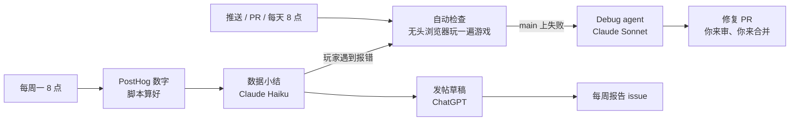

# 飞行搭档的 Agentic Workflow

三个 agent，用 GitHub Actions 的固定规则串起来。哪个 AI 做哪件事，按"这件事需要多聪明"和"省 token"来分：

| Agent | 谁来做 | 为什么 | 什么时候跑 | 每次大概花多少 |
|---|---|---|---|---|
| Debug agent | Claude Sonnet 5.5 | 要读代码、改代码、跑测试，需要最强的写代码能力 | 每次推送、每个 PR、每天 8 点自动检查；只有 main 上检查失败才叫 Claude | 检查本身免费；一次修复约 $0.5 到 $2，只有出错时才花 |
| 数据分析 agent | 脚本 + Claude Haiku 5.5 | 数字由脚本算好，Claude 只读几百个 token 写中文小结，用最便宜的模型就够 | 每周一 8 点 | 不到 $0.01 |
| 社媒文案 agent | ChatGPT（gpt-6.1-terra） | 写短视频文案，便宜又够用；只出草稿，从不发帖 | 每周一 8 点，接在数据分析后面 | 约 $0.02 |
| 协调 | 固定规则，不用 AI | 判断"该谁跑"不需要 AI，写成规则最省钱也最稳 | 跟着每周报告 | 免费 |

仓库是公开的，GitHub Actions 运行不收钱。算下来每周大约 **$0.03**，加上出 bug 时偶尔一次的修复费。



## 指挥台：一眼看完所有 agent

打开 https://rickylgd.github.io/fluffy-pilots/agents/dashboard/ （手机上也能看）。

- 两条线：A 线守护游戏（检查 → Debug agent → 修复 PR → 你），B 线每周报告（数据 agent → 文案 agent → 协调规则 → 报告 → 你）。
- 每个节点显示谁在做（Claude、ChatGPT 还是固定规则）、上次跑的结果、什么时候、大概花多少钱，点进去是那次的运行记录、PR 或 issue。
- 最上面一句话告诉你现在一切正常、正在跑，还是需要你看；"等你处理"列出要审的 PR 和没关的报告。
- 数据来自 GitHub 公开的运行记录，页面里没有 key。每 10 分钟自动刷新一次，有东西在跑时每分钟一次。

页面的代码在 `agents/dashboard/index.html`。

## 每周报告里有什么

每周一会在仓库的 Issues 里出现一个"每周报告"：

1. **数据小结**：这周和上周比，访客、玩家、局数、分数、新功能有没有人用、报错。
2. **下周发帖草稿**：3 条短视频（2 条 Reels，1 条 TikTok），每条有开头 2 秒、拍什么、文案、标签。
3. 如果玩家比上周少一半以上，或者玩家遇到了报错，最上面会有 ⚠️，issue 会多一个 needs-attention 标签。遇到报错时，debug agent 会自动去检查游戏。

想改发帖方向：改 `agents/game-brief.md`。想推这周的新东西：在 `agents/news.md` 写一两句。

## 你需要做的设置（一次）

都在仓库 **Settings → Secrets and variables → Actions → New repository secret**：

| Secret 名字 | 从哪里拿 | 给谁用 |
|---|---|---|
| `ANTHROPIC_API_KEY` | console.anthropic.com → API Keys（先在 Billing 充一点钱，$5 够用很久） | Debug agent、数据分析 agent |
| `OPENAI_API_KEY` | platform.openai.com → API keys（先在 Billing 充一点钱；ChatGPT Plus 订阅不包含 API） | 社媒文案 agent |
| `POSTHOG_PERSONAL_API_KEY` | PostHog 右上角头像 → Settings → Personal API keys → Create，权限只给 Query 的 Read | 数据分析 agent |

另外：Settings → Actions → General 最下面，勾选 "Allow GitHub Actions to create and approve pull requests"，保存。Debug agent 要靠它开修复 PR。

哪个 key 没加，对应的 agent 就跳过，报告里会写明。加好以后，在 Actions 页面选 "Weekly report" → "Run workflow" 就能马上试一次。

## 可以改的设置（不改也行）

Settings → Secrets and variables → Actions → Variables：

- `SOCIAL_MODEL`：文案用的 ChatGPT 模型，默认 `gpt-6.1-terra`。想更便宜可以填 `gpt-6-luna`。
- `CAPTION_LANGUAGE`：文案语言，默认"中文和英文各一版"。
- `ANALYTICS_MODEL`：数据小结用的 Claude 模型，默认 `claude-haiku-5-5`。
- `POSTHOG_PROJECT_ID`（默认 716874）和 `POSTHOG_TEST_COHORT_ID`（默认 698355，你的测试设备，不算进数据）。

## 安全

- 三个 agent 都只能开 PR 或 issue，不会推送到 main，不会合并，不会发帖。
- 数据分析和文案 agent 只调用 API，没有改代码、跑命令的权限。
- PostHog key 只有读数据的权限。

## 在自己电脑上试

```
cd agents
npm ci
POSTHOG_PERSONAL_API_KEY=... POSTHOG_PROJECT_ID=716874 POSTHOG_TEST_COHORT_ID=698355 ANTHROPIC_API_KEY=... node analytics.mjs
OPENAI_API_KEY=... node social.mjs
node report.mjs
```

结果在 `agents/out/` 里。
